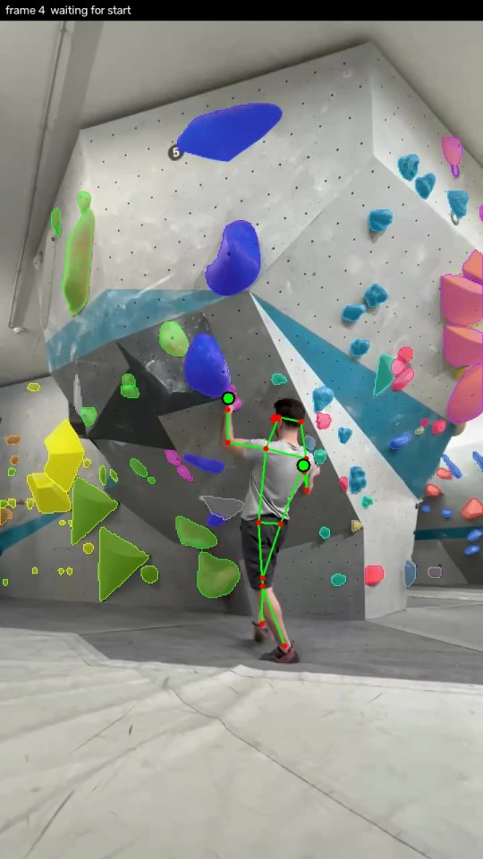
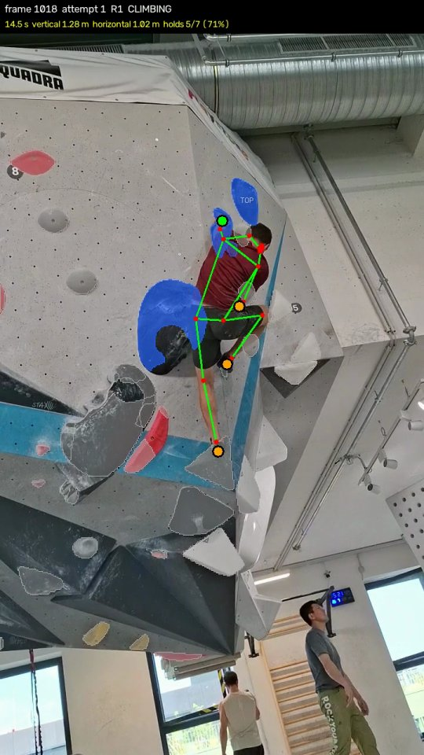
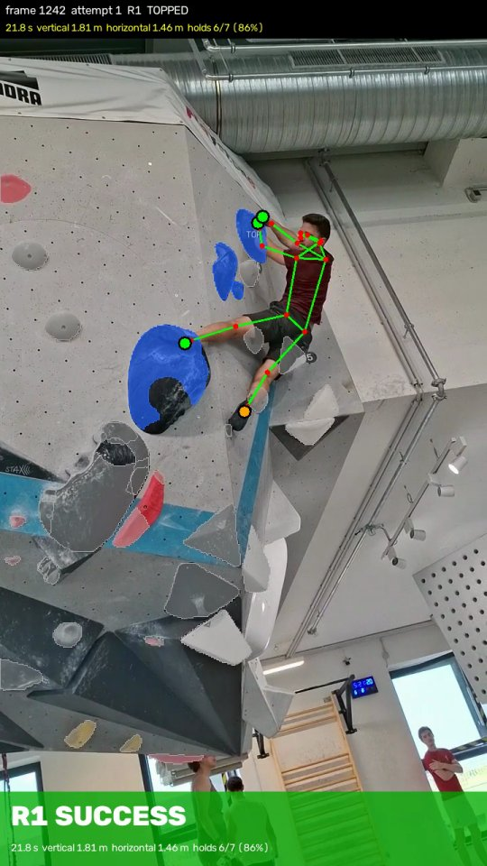

# sport_analysis

> 🚧 **Work in progress.** This project is still being built: results are experimental, and the code, CLI options, and output formats may change.

Computer-vision analysis of sports videos. The first module is **bouldering**: from a phone video of a climbing wall, it finds the holds, groups them into routes, tracks the climber's pose, and judges each attempt.

## Results

| Routes detected | Climbing | Success |
|:---:|:---:|:---:|
|  |  |  |
| Holds are segmented with SAM3 and grouped into routes by color and position. | Once the climber starts, only the active route stays in color; hands and feet are tracked with ViTPose+. | Both hands on the top hold → success, with time, distance and holds used. |

## What it does

- Segments and tracks climbing holds (SAM3 / EfficientSAM3), following camera motion between keyframes
- Groups holds into routes and detects which route is being climbed
- Estimates the climber's pose (ViTPose+) and which holds their hands and feet touch
- Detects attempt start, success (topped) or failure (fell, lost, did not reach the top)
- Reports per-attempt metrics: time, vertical / horizontal distance, holds used
- Runs on PyTorch or ONNX Runtime

## Quick start

```bash
pip install -r requirements.txt
pip install -e efficientsam3      # provides the `sam3` package (submodule)

python -m bouldering export-onnx                     # once, for --backend onnx
python -m bouldering climb --backend onnx --stride 2 --video data/bouldering/bouldering1.mp4
```

Model weights go in `checkpoints/`. See [bouldering/README.md](bouldering/README.md) for setup, all commands and options, and [bouldering/climb/README.md](bouldering/climb/README.md) for how the attempt-judging pipeline works.

## License

See [LICENSE](LICENSE).
